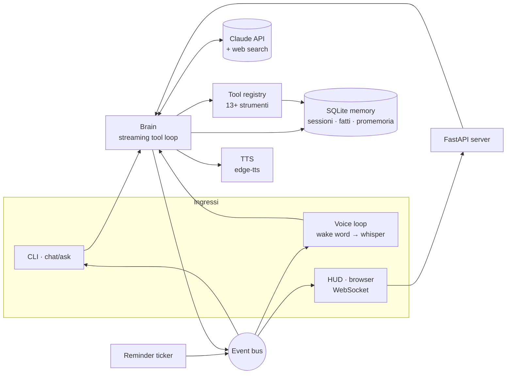

<p align="center">
  <strong style="font-size:1.6em">J.A.R.V.I.S.</strong><br>
  <em>Just A Rather Very Intelligent System</em><br>
  Un maggiordomo digitale fedele all'originale: voce, memoria, strumenti, HUD. Costruito su Claude.
</p>

---

**Italiano** · [English](#english)

## Cos'è

Jarvis è un assistente personale che vive sul tuo computer. Lo chiami per nome, gli parli, e lui risponde con la calma e l'ironia britannica che conosci: ti chiama "Signore" (o come preferisci), controlla il meteo, cerca sul web, ricorda quello che gli dici, imposta promemoria e timer, legge e scrive file, esegue comandi (solo con il tuo permesso), controlla la casa, guarda lo schermo o la webcam e, soprattutto, non finge mai di aver fatto qualcosa che non ha fatto.

Il cervello è Claude (modello predefinito `claude-opus-5-5`), usato attraverso l'SDK ufficiale Anthropic con tool use in streaming, ricerca web lato server e cache del prompt. Tutto il resto, dalla voce alla memoria, gira in locale.

## Caratteristiche

| Area | Cosa fa |
|---|---|
| **Personalità** | Prompt di sistema scritto per il personaggio: conciso, educato, asciutto, protettivo. Risponde nella lingua in cui gli parli (italiano o inglese, turno per turno). |
| **Voce** | Wake word "Hey Jarvis" (openWakeWord), trascrizione locale con faster-whisper, voce neurale britannica `en-GB-RyanNeural` (edge-tts, gratuita) o italiana `it-IT-DiegoNeural`; ElevenLabs e pyttsx3 opzionali. Parla frase per frase mentre la risposta arriva. |
| **HUD** | Interfaccia web stile reattore ad arco: stato animato (ascolto, elaborazione, strumento, parlato), trascrizione in streaming, microfono e wake mode dal browser, approvazioni con un click. |
| **Strumenti** | ora e data · meteo (Open-Meteo, senza chiave) · ricerca e lettura web (server-side Anthropic) · diagnostica di sistema · shell · file (in una cartella sandbox) · **ricerca nei documenti** (PDF, Word, testi: indice BM25 locale, risposte con file e pagina) · promemoria e timer · memoria a lungo termine · ricerca nelle conversazioni passate · calcolatrice · notizie RSS · apertura di URL e applicazioni · Home Assistant · visione (schermo e webcam). |
| **Conoscenza** | Jarvis impara: quando studia un argomento sul web (ricerca e lettura delle pagine), legge un documento o gli si insegna qualcosa ("impara che…"), salva una scheda con la fonte. Nell'app desktop le schede sono file Markdown in `~/jarvis-workspace/conoscenza`, cercati insieme ai documenti; nel browser stanno nel dispositivo, si esportano e si importano in JSON. Le schede pertinenti entrano da sole nel contesto di ogni domanda. |
| **HUD olografico** | Interfaccia a cabina di pilotaggio condivisa da app desktop e browser: reattore animato che cambia colore con lo stato (ascolto, ragionamento, voce), telemetria reale (CPU con grafico, memoria, disco, batteria, temperatura nell'app desktop; rete, batteria, GPU e fotogrammi nel browser), sequenza d'avvio. Reattore e stile stanno in `jarvis/server/static/hud/`; `scripts/sync-hud.py` li copia nell'app web e nel sito. |
| **Memoria** | SQLite: sessioni di conversazione persistenti, fatti a lungo termine (`remember`/`recall`), promemoria. Le sessioni lunghe vengono riassunte e riaperte da capo, così il contesto non esplode. |
| **Sicurezza** | Le azioni pericolose (comandi shell, lancio di applicazioni) richiedono conferma: in terminale, con la voce ("procedi?") o nel HUD. I file sono confinati in `~/jarvis-workspace`. |
| **Affidabilità** | Validazione degli input dei tool, gestione di `max_tokens`/`refusal`/`pause_turn`, fallback server-side sui rifiuti, retry sugli errori dell'API, test offline con un client finto. |

## Due cervelli: Claude, oppure un modello locale senza chiave API

| | Claude (consigliato) | Modello locale con Ollama |
|---|---|---|
| Serve | una chiave API Anthropic (o l'accesso `ant auth login`), a consumo | solo [Ollama](https://ollama.com) installato sul PC; gratis, nessun account |
| Qualità | la replica più fedele: ragiona, usa gli strumenti con precisione, ricerca web lato server | buona con `qwen3:8b`; più lenta e meno precisa, ricerca web locale via DuckDuckGo |
| Privacy | le conversazioni passano per l'API Anthropic | tutto resta sul PC |
| Hardware | qualsiasi | 8 GB di RAM per `qwen3:4b`, 16 GB per `qwen3:8b`, una GPU aiuta molto |

Con `JARVIS_PROVIDER=auto` (default) Jarvis usa Claude se trova una chiave e altrimenti il modello locale.

**Solo Claude, mai Ollama.** Per usare sempre Claude e non scaricare né avviare il motore locale:

```bash
jarvis claude          # chiede la chiave API (senza mostrarla), la verifica e la salva in ~/.jarvis/.env
```

Il comando scrive `ANTHROPIC_API_KEY` e `JARVIS_PROVIDER=anthropic`. Nell'app installata non serve il terminale: se manca la chiave, la finestra di J.A.R.V.I.S. apre un pannello dove incollarla; salvandola, Jarvis passa subito a Claude e annulla l'eventuale download del modello locale. La chiave si crea su [console.anthropic.com](https://console.anthropic.com/settings/keys).

Per la modalità locale:

```bash
# 1. installa Ollama (Linux; su macOS/Windows: scarica da ollama.com)
curl -fsSL https://ollama.com/install.sh | sh
# 2. scarica un modello con supporto agli strumenti
ollama pull qwen3:8b        # oppure qwen3:4b se il PC è piccolo, qwen3:14b se è grande
# 3. lascia vuota ANTHROPIC_API_KEY nel file .env e avvia Jarvis
jarvis doctor && jarvis
```

Nota: la sottoscrizione Claude (Pro/Max) non si può usare da applicazioni di terze parti come Jarvis; serve la chiave API o il modello locale.

## Installazione con un click (consigliata)

Dalla pagina [Releases](https://github.com/antoniodifranco79-lab/jarvis/releases/latest) scarica l'installer per il tuo sistema:

| Sistema | File | Poi |
|---|---|---|
| Windows | `JARVIS-Setup-<versione>-win64.exe` | installazione guidata, icona sul desktop e nel menu Start |
| macOS | `JARVIS-<versione>-macos.dmg` | trascina J.A.R.V.I.S. in Applicazioni |
| Ubuntu / Debian | `jarvis_<versione>_amd64.deb` | doppio clic, Installa: compare nel menu e sul desktop |

Al primo avvio l'app scarica da sola il motore AI (Ollama, 0,2-1,6 GB a seconda del sistema) e il modello linguistico adatto alla memoria del PC (qwen3 da 1,7 a 8 miliardi di parametri, 1-5 GB), mostrando l'avanzamento nella finestra. Non serve installare nient'altro, né una chiave API.

## Nel browser, senza installare nulla (tablet e Chromebook)

La cartella `web/` è J.A.R.V.I.S. in versione web app: stessa interfaccia, voce dal browser, promemoria, meteo, calcoli, memoria, Wikipedia, **chat con i documenti** (PDF, Word e testi letti e cercati nel browser, risposte con le fonti), **strumenti da studio** (IVA, fattura del professionista con cassa e ritenuta, scadenze con festività, verifica di codice fiscale, partita IVA e IBAN), e il modello linguistico (Qwen3 da 0,6 a 8 miliardi di parametri via WebLLM, scelto in automatico in base al dispositivo, con ragionamento approfondito opzionale) che gira **dentro Chrome** grazie a WebGPU. Niente account, niente chiavi: al primo avvio scarica il modello (1-3 GB, una volta sola) e poi funziona anche offline.

Funziona **gratis e senza chiave su qualunque dispositivo**: se il browser ha la grafica accelerata (WebGPU) il modello gira sulla scheda grafica con WebLLM; altrimenti, o se il caricamento fallisce, passa da solo a llama.cpp in WebAssembly (`web/cpuengine.js`, wllama) con Qwen3 0.6B o 1.7B sul processore. Durante il primo download l'app mostra percentuale e megabyte, mette in coda le domande e risponde appena il cervello è pronto; se nessun motore parte, spiega il motivo. "Studia …" funziona anche senza modello: legge Wikipedia e salva una scheda di conoscenza. Il cervello predefinito è il modello locale (Qwen3 via WebLLM, da 0,6 a 8 miliardi di parametri scelti in base al dispositivo), che usa gli stessi strumenti di Claude con il formato `<tool_call>` di Qwen3: documenti, conoscenza, calcoli da studio, meteo, promemoria e Wikipedia per studiare e imparare. Claude resta un'opzione avanzata nelle impostazioni, con la propria chiave API.

**Voce.** `web/voice.js` sceglie la voce più naturale del dispositivo (prima le voci neurali Microsoft "Natural" di Edge, poi quelle di rete Google, poi le Premium di Apple, mai le voci robotiche), legge a frasi brevi con l'intonazione naturale e prepara il testo come lo direbbe una persona: importi in euro e centesimi, percentuali, date per esteso, ore, abbreviazioni sciolte, niente citazioni né link. Nelle impostazioni si sceglie la voce, maschile o femminile e la velocità. L'app desktop applica la stessa pulizia (`jarvis/voice/speechtext.py`) alle voci neurali Microsoft di edge-tts.

Si pubblica con GitHub Pages dal ramo `gh-pages`, che il workflow `pages.yml` ricostruisce a ogni modifica di `site/` o `web/`: la web app risponde a `https://<utente>.github.io/jarvis/app/`, mentre la radice `https://<utente>.github.io/jarvis/` è il sito di Leonardo Di Franco (cartella `site/`, vedi [docs/BUSINESS-PLAN.md](docs/BUSINESS-PLAN.md)). Da Chrome su Android: "Aggiungi a schermata Home". Richiede Chrome aggiornato e Android 12 o più recente per WebGPU; senza WebGPU restano attivi gli strumenti.

## Su tablet Android (Termux)

Su Android non esistono installer, ma Jarvis gira lo stesso, con il modello sul tablet (consigliati 8 GB di RAM):

1. Installa **Termux** da [F-Droid](https://f-droid.org/packages/com.termux/) (la versione sul Play Store è vecchia e non funziona) e, se vuoi un'icona di avvio, **Termux:Widget**.
2. Apri Termux e incolla:
   ```bash
   curl -fsSL https://raw.githubusercontent.com/antoniodifranco79-lab/jarvis/HEAD/scripts/install-android.sh | bash
   ```
3. Alla fine Jarvis si apre in Chrome. Le volte successive: scrivi `jarvis-start` in Termux, oppure tocca il widget **JARVIS**. In Chrome, "Aggiungi a schermata Home" crea l'icona.

Microfono e voce funzionano dal browser (Chrome). Niente chiavi: tutto resta sul tablet.

## Installazione da sorgenti

Serve Python 3.10+. Per la voce servono anche `ffmpeg` e PortAudio. Il cervello è Claude con una chiave API, oppure un modello locale gratuito (vedi sopra).

**Linux / macOS / WSL**

```bash
curl -fsSL https://raw.githubusercontent.com/antoniodifranco79-lab/jarvis/HEAD/scripts/install.sh | bash
```

**Windows (PowerShell)**

```powershell
irm https://raw.githubusercontent.com/antoniodifranco79-lab/jarvis/HEAD/scripts/install.ps1 | iex
```

L'installer clona il repository in `~/jarvis`, crea un ambiente virtuale, installa `jarvis-ai[server,voice,vision,local]`, crea il file `.env` e chiede la chiave API (lasciala vuota per usare il modello locale). (Per installare un ramo specifico: `JARVIS_BRANCH=nome-ramo` prima del comando.)

**A mano**

```bash
git clone https://github.com/antoniodifranco79-lab/jarvis.git && cd jarvis
python3 -m venv .venv && source .venv/bin/activate
pip install -e ".[server,voice,vision]"      # oppure solo ".[server]" senza microfono
cp .env.example .env                          # inserisci ANTHROPIC_API_KEY
jarvis doctor
```

Dipendenze di sistema per la voce: `sudo apt install ffmpeg portaudio19-dev` (Debian/Ubuntu), `brew install ffmpeg portaudio` (macOS). Su Windows basta `ffmpeg` nel PATH.

## Uso

```bash
jarvis                 # chat in terminale (/new, /memory, /reminders, /quit)
jarvis chat --speak    # chat in terminale con risposte lette ad alta voce
jarvis ask "che ore sono a Tokyo?"
jarvis voice           # mani libere: di' "Hey Jarvis", poi parla
jarvis voice --push-to-talk   # premi Invio invece della wake word
jarvis serve           # HUD su http://127.0.0.1:8765
jarvis doctor          # verifica configurazione e componenti opzionali
jarvis memory          # cosa ricorda   ·   jarvis memory forget 3
jarvis reminders       # promemoria in sospeso
```

Esempi di cose da dirgli:

> "Jarvis, com'è il tempo oggi?" · "Ricordami alle sette di chiamare mia madre" · "Timer dieci minuti" · "Ricorda che il mio dentista è il dottor Rossi" · "Cosa c'è nelle notizie?" · "Fai una diagnostica" · "Cosa vedi sullo schermo?" · "Spegni le luci in cucina" · "Scrivi una nota con la lista della spesa" · "Quanto fa il 22% di 1.850?"

Nel HUD: scrivi, oppure tieni premuto il microfono, oppure attiva la *wake mode* e di' "Jarvis, …". Le azioni che richiedono conferma compaiono con i pulsanti *allow* / *deny*.

## App desktop

```bash
jarvis app                      # finestra nativa con il HUD, wake word attiva, icona nella barra
jarvis app --install-shortcut   # aggiunge J.A.R.V.I.S. al menu applicazioni / Start / cartella Applicazioni
jarvis app --no-voice           # senza microfono
```

L'installer aggiunge il collegamento da solo: dopo l'installazione cerca "J.A.R.V.I.S." tra le applicazioni (Linux e Windows) o in `~/Applications` (macOS). La finestra usa il componente web del sistema (`pywebview`: WebView2 su Windows, WebKit su macOS, WebKitGTK o Qt su Linux); se non è disponibile, si apre nel browser.

Dal telefono: avvia `jarvis serve --host 0.0.0.0`, apri `http://IP-del-PC:8765` e usa "Aggiungi a schermata Home": il HUD è una web app installabile. Il microfono del browser funziona solo su connessioni sicure, quindi dal telefono si scrive o si usa la voce del PC.

Pacchetto autonomo (senza Python installato): `bash scripts/build-app.sh` produce `dist/JARVIS` (`JARVIS.app` su macOS) con PyInstaller; il workflow `release.yml` lo costruisce per Linux, macOS e Windows a ogni tag `v*`. L'app autonoma legge la configurazione da `~/.jarvis/.env`.

## Configurazione

Tutto si regola con variabili d'ambiente (o nel file `.env`), prefisso `JARVIS_`. Le principali:

| Variabile | Default | Note |
|---|---|---|
| `ANTHROPIC_API_KEY` | | vuota = modello locale |
| `JARVIS_PROVIDER` | `auto` | `auto`, `anthropic`, `ollama` |
| `JARVIS_MODEL` | `claude-opus-5-5` | qualsiasi modello Claude attuale |
| `JARVIS_OLLAMA_MODEL` | `qwen3:8b` | modello locale (deve supportare i tool) |
| `JARVIS_OLLAMA_URL` | `http://127.0.0.1:11434` | server Ollama |
| `JARVIS_OLLAMA_NUM_CTX` | `16384` | finestra di contesto del modello locale |
| `JARVIS_EFFORT` | `medium` | `low` per risposte più rapide, `high`/`xhigh` per compiti difficili |
| `JARVIS_USER_NAME` | `Sir` | come ti chiama: `Signore`, il tuo nome… |
| `JARVIS_LANGUAGE` | `auto` | `auto` = risponde nella tua lingua; `it`/`en` per forzarla |
| `JARVIS_LOCATION` | | città predefinita per il meteo, es. `Milano, IT` |
| `JARVIS_AUTO_APPROVE` | `false` | `true` esegue shell e app senza chiedere (attenzione) |
| `JARVIS_WEB_SEARCH` / `JARVIS_WEB_FETCH` | `true` | ricerca e lettura web lato server Anthropic |
| `JARVIS_TTS_ENGINE` | `edge` | `edge`, `elevenlabs`, `pyttsx3`, `none` |
| `JARVIS_TTS_VOICE_EN` / `_IT` | `en-GB-RyanNeural` / `it-IT-DiegoNeural` | voci edge-tts |
| `JARVIS_STT_MODEL` | `small` | dimensione whisper: `tiny`…`large-v3` |
| `JARVIS_WAKE_WORD` | `hey_jarvis` | modello openWakeWord |
| `JARVIS_HOME_ASSISTANT_URL` / `_TOKEN` | | abilita il tool domotico |
| `JARVIS_NEWS_FEEDS` | BBC, ANSA | feed RSS separati da virgola |

L'elenco completo è in [`.env.example`](.env.example) e in [`jarvis/config.py`](jarvis/config.py).

## Architettura



- **`jarvis/persona.py`**: il carattere. Il prompt di sistema è congelato per tutta la sessione (niente orologio dentro), così la cache del prompt resta calda e la conversazione è *append-only*, come richiesto dal controllo di coerenza dello storico dei modelli attuali. L'ora corrente viaggia in un messaggio di contesto per turno.
- **`jarvis/brain.py`**: il ciclo agentico con `client.beta.messages.stream`: eventi di testo in streaming, esecuzione parallela dei tool, risultati rimandati in un unico messaggio, gestione di `pause_turn`, `max_tokens`, `refusal`, JSON malformato; `fallbacks="default"` per i rifiuti; rollover di sessione con riassunto oltre il budget di token.
- **`jarvis/tools/`**: un decoratore trasforma funzioni Python tipizzate in tool (schema JSON generato dalla firma e dalla docstring), un registro li valida ed esegue con timeout; i tool pericolosi passano da un *approver*.
- **`jarvis/memory.py`**: SQLite con sessioni, messaggi nel formato esatto dell'API, fatti e promemoria.
- **`jarvis/voice/`**: `wakeword.py` (openWakeWord), `audio.py` (registrazione fino al silenzio), `stt.py` (faster-whisper), `tts.py` (edge-tts / ElevenLabs / pyttsx3), `sentences.py` (spezza lo streaming in frasi da pronunciare), `loop.py` (il ciclo mani libere con conferme vocali).
- **`jarvis/server/`**: FastAPI + WebSocket, audio sintetizzato inviato al browser, approvazioni, API REST (`/api/status`, `/api/ask`, `/api/reminders`, `/api/memory`).
- **`jarvis/providers/ollama.py`**: adattatore che espone a `brain.py` la stessa interfaccia dell'SDK Anthropic ma parla con Ollama: i messaggi restano salvati in un solo formato, e `tools/web_local.py` fornisce ricerca e lettura web locali quando il cervello è il modello locale.

## Sviluppo

```bash
pip install -e ".[all]"
pytest -q            # 34 test offline con un client Anthropic finto
ruff check jarvis tests
docker compose up --build   # HUD in container (solo testo + voce nel browser)
```

## Note e limiti

- I modelli Claude più recenti vincolano i blocchi di ragionamento alla conversazione: per questo Jarvis non modifica mai lo storico, lo estende soltanto, e apre una sessione nuova (riassunta) quando serve.
- La wake word usa openWakeWord quando è installato; su Linux con Python 3.12+ l'installer lo aggiunge senza dipendenze (`pip install --no-deps openwakeword`) e, se manca, Jarvis ascolta il proprio nome con Whisper. In alternativa: `jarvis voice --push-to-talk` o la wake mode del HUD.
- Il tool `look` (schermo/webcam) richiede `pip install "jarvis-ai[vision]"`.
- Home Assistant funziona con un *long-lived access token* (Profilo → Sicurezza).

---

## English

**J.A.R.V.I.S.** is a faithful personal-AI butler built on Claude: a written-for-character persona, a streaming tool-using brain, persistent memory, a voice stack (wake word, local Whisper, free neural British voice) and an arc-reactor HUD.

**Two brains**: Claude through the Anthropic API (best), or a free local model through [Ollama](https://ollama.com) with no API key at all (`ollama pull qwen3:8b`, leave `ANTHROPIC_API_KEY` empty). `JARVIS_PROVIDER=auto` picks Claude when a key exists and the local model otherwise.

**Install**

```bash
curl -fsSL https://raw.githubusercontent.com/antoniodifranco79-lab/jarvis/HEAD/scripts/install.sh | bash
# Windows: irm https://raw.githubusercontent.com/antoniodifranco79-lab/jarvis/HEAD/scripts/install.ps1 | iex
```

or manually: `pip install -e ".[server,voice,vision]"`, copy `.env.example` to `.env`, set `ANTHROPIC_API_KEY`, run `jarvis doctor`.

**Run**: `jarvis app` (desktop app: native window + wake word; `--install-shortcut` adds a launcher) · `jarvis` (terminal chat) · `jarvis voice` (hands-free) · `jarvis serve` (HUD at http://127.0.0.1:8765, installable as a web app) · `jarvis ask "..."`. Standalone builds: `scripts/build-app.sh` (PyInstaller) and the release workflow.

**Tools**: date/time, weather, web search & fetch (Anthropic server tools), system diagnostics, shell (with approval), sandboxed files, reminders & timers, long-term memory, conversation search, calculator, RSS news, open URLs/apps, Home Assistant, screen & camera vision.

**Design**: frozen per-session system prompt + append-only history (prompt-cache friendly, compatible with the history-editing check on current models), live clock in a per-turn context message, validated tool inputs with eager input streaming, server-side refusal fallbacks, session roll-over with a summary. Configuration via `JARVIS_*` environment variables (see `.env.example`). 34 offline tests (`pytest`).

MIT License.
